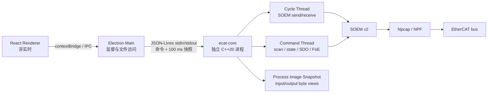

# ECAT Bench 软件架构

## 1. 架构原则

1. GUI 与实时 I/O 隔离：Renderer 不直接访问网卡，也不调用 SOEM。
2. 状态所有权唯一：主站状态由原生核心修改，GUI 只提交命令并渲染快照。
3. 控制面与过程数据分离：命令使用 JSON-Lines；高频 PDO 留在原生过程映像，不逐周期穿过 IPC。
4. 后端可替换：SOEM、原生模拟核心和 TypeScript 模拟核心实现同一桌面桥接接口。
5. 故障边界清晰：核心是独立进程，Electron Main 负责启动、监督和文件选择。

## 2. 组件



### 2.1 Renderer

- React + TypeScript。
- 只保存展示状态、表单草稿和最近操作结果。
- 通过 `window.ecatBridge` 提交命令。
- 快照事件约 10 Hz，不按 1 ms 周期更新 DOM。
- 不进行 SDO、FoE、日志落盘或硬件访问。

### 2.2 Electron Main

- 创建窗口、启用 `contextIsolation`、关闭 `nodeIntegration`。
- 管理核心进程生命周期并广播快照。
- 提供固件与 ENI 文件选择。
- 持久化工作区配置。
- 打包模式从 `resources/native/ecat-core.exe` 启动核心。

核心启动顺序是 SOEM、原生模拟核心、TypeScript 模拟核心。可用 `ECAT_CORE_MODE=soem|sim` 强制模式。

### 2.3 Native Core

- C++20 独立可执行程序。
- `MasterBackend` 为后端抽象。
- `SoemBackend` 使用 SOEM v2 和 Npcap。
- `SimBackend` 为无需硬件、可自动测试的原生模拟后端。
- `JsonLineService` 串行处理命令并发布快照事件。

SOEM 后端使用的主要 API：

- `ecx_init`
- `ecx_config_init`
- `ecx_config_map_group`
- `ecx_configdc`
- `ecx_readstate` / `ecx_writestate` / `ecx_statecheck`
- `ecx_SDOread` / `ecx_SDOwrite`
- `ecx_FOEread` / `ecx_FOEwrite`
- `ecx_send_processdata` / `ecx_receive_processdata`

## 3. 线程与锁

### 3.1 Command Thread

读取 stdin，串行执行配置、扫描、状态迁移、SDO、PDO 写入和 FoE。该线程允许阻塞，但不得直接编码高频过程数据。

### 3.2 Cycle Thread

进入 OP 后启动：

1. 等待绝对目标时刻。
2. 获取 `io_mutex_`。
3. `ecx_send_processdata()`。
4. `ecx_receive_processdata(timeout)`。
5. 如果存在邮箱任务，调用有限步数的 `ecx_mbxhandler(..., 0, 4)`。
6. 将 SOEM 输入区复制到 `input_snapshot_`。
7. 释放 I/O 锁，低频写入遥测快照。

基准运行期间，周期线程逐周期记录实际周期间隔、收发与邮箱步骤耗时、相对绝对目标时刻的调度误差、WKC 和丢帧。Windows 实现设置 `HIGH_PRIORITY_CLASS`、`THREAD_PRIORITY_TIME_CRITICAL`、CPU 亲和性并启用 1 ms timer resolution。它是软实时优化，不是硬实时保证。

### 3.3 Process Image

- `io_map_` 是 SOEM 使用的 64 KiB process image。
- `input_snapshot_` 保存最近一次成功接收的输入字节。
- `output_snapshot_` 保存当前输出字节。
- GUI 快照使用 `index=0000`、`subIndex=字节偏移` 暴露原始 PDO 字节，单次最多 256 字节。
- 原始 PDO 写入同时更新 SOEM `slavelist[n].outputs` 和输出展示快照。
- 锁顺序为 `state_mutex_ -> io_mutex_ -> process_mutex_`；周期路径只使用 `io_mutex_ -> process_mutex_`，并在获取状态锁前释放两者。

### 3.4 Mailbox and FoE

进入 OP 后，后端为每个从站启用 SOEM cyclic mailbox。SDO/FoE 在 cyclic 模式下只增加邮箱任务计数，不持有整个任务期间的 `io_mutex_`；周期线程在 process data 收发后推进有限步数的邮箱状态机。非 OP、状态迁移或 cyclic mailbox 不可用时，邮箱任务回退到持有 `io_mutex_` 的阻塞路径。

FoE 下载通过 SOEM `FOEhook` 更新进度和字节数；上传期间总线仍在传输，但 SOEM 回调只提供剩余累计值，界面显示不确定进度。原始邮箱帧和传输中取消当前返回明确错误。上述路径仍需真实从站和网络硬件验收，不能仅凭模拟或编译结果宣称 1 ms 邮箱并发已通过。

### 3.5 Realtime Benchmark

- 仅当真实核心处于 OP 且存在活动周期线程时启动。
- 固定直方图覆盖 0 至 10000 µs，输出 mean、p50、p95、p99、p99.9 和 max。
- 统计周期时间、收发耗时和绝对调度偏差，并记录超过 1050/1200/2000 µs 的次数。
- 基准运行期间阻止扫描、状态切换、SDO、PDO 写入、FoE、配置修改和 ENI 加载。
- 模拟核心返回 `simulated: true`，报告工具拒绝将其判为验收通过。
- `scripts/realtime-benchmark.mjs` 在 1800 秒自然完成且门槛满足时输出 `accepted`；阈值失败或样本不足时返回非零退出码。

快照路径的 `refresh_slaves_locked()` 只复制缓存的过程映像和 SOEM 从站元数据，不执行额外总线读取，因此不会在 10 Hz 遥测路径中插入 `ecx_readstate` 或邮箱事务。

## 4. IPC

### 4.1 控制面

一行一个 JSON 对象：

```json
{"id":"42","command":"sdo_read","params":{"slaveIndex":1,"index":"6041","subIndex":"00"}}
```

响应保留请求 `id`，返回 `ok`、`message` 和可选 `data`。

### 4.2 遥测面

当前每个快照包含最新遥测、90 个历史点和完整展示状态。正式高频版本可替换为共享内存：

- 固定大小 ring buffer。
- 双缓冲快照和单调版本号。
- GUI 只读取已提交快照。
- 高频 PDO 使用固定二进制布局，不逐周期进行 JSON 编码。

## 5. 状态模型

主站阶段由从站集合中的最慢状态决定：

- 全部 OP：`op`
- 最慢为 SAFE-OP：`safeop`
- 最慢为 PRE-OP 或 INIT：`preop`
- 核心已停止：`offline`

单从站状态与主站组状态分开保存。混合状态不能显示为 OP。

## 6. 安全边界

- 状态切换和 PDO 输出属于危险操作。
- OP 前应检查扫描结果、AL Status、WKC 和现场安全条件。
- FoE 任务期间不得启动第二个任务。
- 核心退出后必须重新扫描，不能自动恢复 OP。
- UI 必须清楚区分 `SIM` 和 `SOEM`。

## 7. 跨平台

### Windows

- Npcap/NPF 原始网卡。
- Npcap SDK 只用于构建，运行时由用户单独安装。
- 使用 Windows 高精度定时器和线程优先级 API。

### Linux

- libpcap/raw socket。
- `SCHED_FIFO` 需要 capability 或 root。
- 建议使用不绑定 NetworkManager 的独立物理接口。

### macOS

- BPF 权限和私有网卡选择流程。
- Apple Silicon 与 Intel 需分别构建。

## 8. 已知缺口

1. 尚无真实从站上的扫描、OP、SDO、PDO 和 FoE 验收记录。
2. 1 ms 周期尚未完成 30 分钟统计验收。
3. Cyclic mailbox 已接入，但尚未证明真实拓扑、网络驱动和邮箱负载下仍满足 1 ms 门槛。
4. ENI 只登记路径，固定映射和启动序列未实现。
5. PDO 当前是原始字节视图，不是 ENI/ESI 符号对象。
6. FoE 下载有进度；上传只能显示不确定进度；传输中取消和主站侧 CRC 校验未实现。
7. 原始任意邮箱帧未开放。
8. 代码签名、公网更新和 SOEM 发布许可尚未完成。
